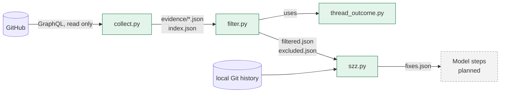
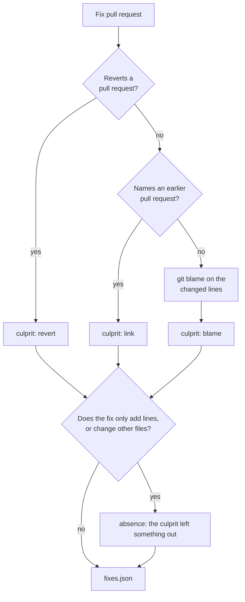

# Review learning

Review learning reads the pull requests that were merged in a time window. It finds what human reviewers and later fixes teach. The goal is to improve the code-review rules in [`.agents/rules/code-review/`](../../.agents/rules/code-review/). The [`system-tests-review`](../../.agents/skills/system-tests-review/SKILL.md) skill applies these rules.

Review learning improves the rules that an agent uses. It does not replace human review. A person always approves each rule change.

## Status

Only the first steps exist today. They collect and prepare the data, and they use no model.

| Step | Script | Status |
| --- | --- | --- |
| 1. Collect | `collect.py` | Done |
| 2. Filter | `filter.py` and `thread_outcome.py` | Done |
| 3. Find culprits | `szz.py` | Done |
| 4. Extract candidates | model | Planned |
| 5. Verify quotes | script | Planned |
| 6. Map to rules | model | Planned |
| 7. Decide and report | script | Planned |

## How it works



Each step is one script. A script reads the run folder and writes its own JSON files. It does not call the other steps. Only `collect.py` uses the network, so you can run the later steps again on the same data.

### Collect

`collect.py` downloads the merged pull requests of the window. It keeps the files, the commits, the reviews, the comments, and the review threads. Each pull request goes to `evidence/<number>.json`. If GitHub cuts a list at the query limit, the `truncated` field names it. A new collect in the same folder deletes the old evidence first.

### Filter

`filter.py` removes the pull requests that a person did not write:

- every pull request from a GitHub App, such as `dd-octo-sts`
- titles of automated pull requests, such as `Update Agent to …` or `Auto-activate … easy wins for …`
- a fixed list of pull requests, such as the ones that created the rules

It also removes every comment that is not a human review. If Codex or another bot opens a thread, the script drops the whole thread. Short comments such as `LGTM` are dropped too.

`thread_outcome.py` then gives each human thread an outcome:

| Outcome | Meaning |
| --- | --- |
| `applied` | GitHub marks the thread as outdated and a later commit exists, or a reply confirms the fix. |
| `disputed` | A reply pushes back, for example "not a bug" or "intended". |
| `discussed` | People replied, but there is no clear result. |
| `resolved` | Someone resolved the thread, but no change is visible. |
| `ignored` | Nobody replied and nothing changed. |

### Find culprits

`szz.py` looks for fix pull requests. For each fix, it finds the earlier pull request that brought the defect. It uses the local Git history. Each squash commit on `main` ends with `(#<number>)`, so the script needs no network.



The blame skips commits that only touch the build, docs, or format. If a file has only additions, the script blames the line above each insertion. The blame code comes from [sphinx](https://github.com/ddoghq-sandbox/jb-claude-marketplace/tree/main/sphinx).

## Run it

Run the commands from the repository root, with the repository virtual environment:

```bash
venv/bin/python -m utils.scripts.review_learning.collect --window 30d --out .review-learning/run
venv/bin/python -m utils.scripts.review_learning.filter --run .review-learning/run
venv/bin/python -m utils.scripts.review_learning.szz --run .review-learning/run
```

The `--window` option takes a number of days that ends today, such as `30d`, or a date range, such as `2026-10-01..2026-10-31`. Without `--out`, the run goes to `.review-learning/<start>..<end>`.

You can also look at one pull request:

```bash
venv/bin/python -m utils.scripts.review_learning.thread_outcome --run .review-learning/run --pr 8399
venv/bin/python -m utils.scripts.review_learning.szz --fix-pr 8399
```

Git ignores the `.review-learning/` folder. A run of 30 days takes about 6 MB. To delete old runs:

```bash
venv/bin/python -m utils.scripts.review_learning.clean            # keep the 3 newest runs
venv/bin/python -m utils.scripts.review_learning.clean --keep 1
venv/bin/python -m utils.scripts.review_learning.clean --all
venv/bin/python -m utils.scripts.review_learning.clean --dry-run  # list them, delete nothing
```

The script deletes only the folders directly under `.review-learning/` that hold an `index.json`. It never follows a symbolic link. In CI, the job folder goes away with the job, so CI needs no cleanup.

## Output files

| File | Content |
| --- | --- |
| `index.json` | The window and the list of downloaded pull requests |
| `evidence/<number>.json` | One pull request, as GitHub returned it, in a flat shape |
| `excluded.json` | The pull requests that were left out, each with the reason |
| `filtered.json` | The pull requests to mine, with human comments and thread outcomes |
| `fixes.json` | The fix pull requests, their culprits, and the absence flag |

## Configuration

[`filters.yml`](../../utils/scripts/review_learning/filters.yml) holds the excluded authors, titles, labels, and pull request numbers. It also holds the ignored commenters and the size limits. Patterns match the whole value and ignore case. Only `*` is a wildcard.

## Tests

```bash
./run.sh TEST_THE_TEST tests/test_the_test/test_review_learning.py
```

The tests use no network. They build their data in the test file, and they create temporary Git repositories for the blame.

## Known limits

- A link can point to a related pull request instead of the culprit.
- A pull request that turns a test on again can look like a revert. Such a pull request fixes no defect.
- The model steps will judge both cases. They do not exist yet.
