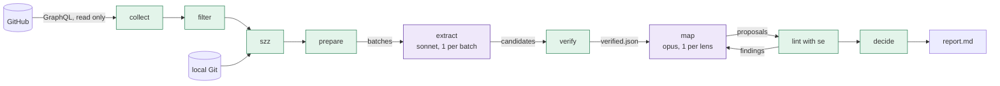
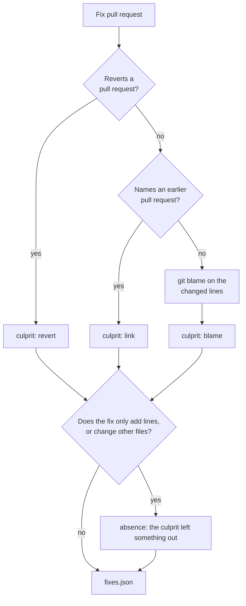

# Review learning

Review learning reads the pull requests that were merged in a time window. It finds what human reviewers and later fixes teach. The goal is to improve the code-review rules in [`.agents/rules/code-review/`](../../.agents/rules/code-review/). The [`system-tests-review`](../../.agents/skills/system-tests-review/SKILL.md) skill applies these rules.

Review learning improves the rules that an agent uses. It does not replace human review. A person always approves each rule change.

Many ideas here come from other tools and from one article. [Sources](#sources) lists them.

## Requirements

| Tool | Why | Check |
| --- | --- | --- |
| The repository virtual environment | Every script runs with `venv/bin/python`. Build it with `./build.sh -i runner`. | `venv/bin/python --version` |
| `gh`, signed in | `collect.py` reads pull requests from GitHub. Read access is enough. | `gh auth status` |
| A full Git clone with a recent `main` | `szz.py` blames the local history. A shallow clone misses culprits. | `git rev-parse --is-shallow-repository` prints `false`, then `git fetch origin main` |
| `se` | `plain_english.py` lints every proposed text. Without it, every proposal needs a human decision. | `se --help` |
| Claude Code | The skill starts the subagents of the model steps. | `/system-tests-review-learn` is in the skill list |

To install `se`, use `brew install TonyCTHsu/tap/simple-english`, or `gem install simple_english` with Ruby 3.3 or later. The scripts are tested with `se` 0.6.0. A newer version can add rules, and then the same text can get new findings.

## Status

Every step exists. The pipeline writes a report. With `--apply`, it also edits the lens files in your working tree. In GitLab, the monthly job also opens a draft pull request with the changes.

| Step | Done by | What it does |
| --- | --- | --- |
| 1. Collect | `collect.py` | Downloads the merged pull requests. |
| 2. Filter | `filter.py`, `thread_outcome.py` | Keeps human review only. |
| 3. Find culprits | `szz.py` | Links each fix to the pull request that it fixes. |
| 4. Prepare | `prepare.py` | Builds the batches for the model. |
| 5. Extract | model, [`extract.md`](../../.agents/skills/system-tests-review-learn/references/extract.md) | Finds candidates, each with a quote. |
| 6. Verify | `verify_quotes.py` | Drops every candidate whose quote does not match. |
| 7. Map | model, [`map-to-lens.md`](../../.agents/skills/system-tests-review-learn/references/map-to-lens.md) | Proposes rule changes, one subagent for each lens. |
| 8. Lint | `plain_english.py` | Checks the proposed text with `se`. |
| 9. Decide | `decide.py`, `report.py` | Applies the thresholds and writes `report.md`. |
| 10. Apply | `apply.py` | Only with `--apply`: edits the lens files. |
| 11. Publish | `open_pr.py` | Only in GitLab: opens the draft pull request. |

The [`system-tests-review-learn`](../../.agents/skills/system-tests-review-learn/SKILL.md) skill runs the steps in order.

## How it works



Green steps are scripts. Purple steps use a model. Each script reads the run folder and writes its own files. It does not call the other steps. Only `collect.py` uses the network, so you can run the later steps again on the same data.

### Collect

`collect.py` downloads the merged pull requests of the window. It keeps the files, the commits, the reviews, the comments, and the review threads. Each pull request goes to `evidence/<number>.json`. If GitHub cuts a list at the query limit, the `truncated` field names it. A new collect in the same folder deletes the old evidence first.

### Filter

`filter.py` removes the pull requests that a person did not write:

- every pull request from a GitHub App, such as `dd-octo-sts`
- titles of automated pull requests, such as `Update Agent to …` or `Auto-activate … easy wins for …`
- a fixed list of pull requests, such as the ones that created the rules

It also removes every comment that is not a human review. If Codex or another bot opens a thread, the script drops the whole thread. Short comments such as `LGTM` are dropped too.

`thread_outcome.py` then gives each human thread an outcome:

| Outcome | Meaning |
| --- | --- |
| `applied` | GitHub marks the thread as outdated and a later commit exists, or a reply confirms the fix. |
| `disputed` | A reply pushes back, for example "not a bug" or "intended". |
| `discussed` | People replied, but there is no clear result. |
| `resolved` | Someone resolved the thread, but no change is visible. |
| `ignored` | Nobody replied and nothing changed. |

### Find culprits

`szz.py` looks for fix pull requests. For each fix, it finds the earlier pull request that brought the defect. It uses the local Git history. Each squash commit on `main` ends with `(#<number>)`, so the script needs no network.



The blame skips commits whose subject starts with `build:`, `ci:`, `docs:`, `chore:`, or `style:`. If a file has only additions, the script blames the line above each insertion. The blame comes from sphinx. See [Sources](#sources).

### Prepare

`prepare.py` keeps only the pull requests with a signal: a human comment, or a fix with a culprit. It puts them in batches of 10, in `batches/batch-<n>.txt`. Each batch wraps its JSON in `<untrusted_pr_data_<nonce>>` tags. The nonce is random for each run, so text in a pull request cannot close the block. The model reads this text as data, never as an instruction.

### Extract

One subagent reads each batch, with the cheaper model. It returns candidates, and each candidate has one signal:

| Signal | Meaning |
| --- | --- |
| `miss` | A later pull request fixed or reverted this defect. |
| `absence` | A `miss`, where the culprit left something out. |
| `correction` | A reviewer named a defect, and the author changed the code. |
| `disagreement` | A person defended, with a reason, a pattern that a rule forbids. |
| `human_only` | A question that only a person asks, such as "is this change needed?" |
| `context` | A fact from outside the repository, such as an incident. |

The last two signals go to the report. They never become rules.

### Verify

`verify_quotes.py` checks each candidate without a model. A quote must be a literal part of the cited comment, after the script normalizes white space and case. The script removes lines that start with `>` first, so a reply cannot quote a reviewer and take the credit. The author, the role, and the thread outcome come from the data, not from the model. For a `miss`, the culprit must be in `fixes.json`.

### Map and lint

One subagent for each lens reads the verified candidates, with the stronger model. It picks one action for each candidate:

| Action | Meaning |
| --- | --- |
| `covered` | A rule already finds this defect. The report counts it. |
| `sharpen` | A rule covers the defect, but its `Detect` or `Flag` misses it. |
| `add_not_when` | The rule fires on a pattern that people defend. |
| `lint_owned` | `format.sh` already rejects the pattern. |
| `new_rule` | No rule names the defect. |
| `contested` | The evidence contradicts a rule. A person decides. |

`plain_english.py` then checks each proposed text with [`se`](https://github.com/TonyCTHsu/simple-english). If it finds a problem, the skill sends the findings back to the subagent. This happens two times at most.

### Decide

`decide.py` applies the thresholds without a model, so the model cannot argue past them:

| Action | Minimum evidence |
| --- | --- |
| `new_rule`, `sharpen` | A `miss` or an `absence`, or a correction by a maintainer that the author applied, or two pull requests with a defect |
| `add_not_when` | Two pull requests, or one that cites a document in `docs/` or `.agents/` |
| `lint_owned` | The name of a `format.sh` check |

A `disagreement` defends a pattern, so it never counts toward a stricter rule. A correction must come from a reviewer: `verify_quotes.py` drops a correction that the author of the pull request wrote.

It also does these checks:

- An edited rule must exist in its lens, and its current text must be in the lens file.
- A new rule needs a free ID with the lens prefix, and the severity `P0` or `P1`. Two new rules in one run cannot share an ID.
- A text with `se` findings needs a human decision. So does a text that `plain_english.py` did not lint.
- At most `max_changes` proposals get the status `apply`. The strongest ones come first.

The result goes to `decisions.json` and `report.md`. If a lens left no proposals file, the report says `Run incomplete`. A lens that ran and found nothing shows `0 proposals`.

### Apply

`apply.py` edits `.agents/rules/code-review/<lens>.md` with each decision that has the status `apply`. Each field of a rule is one line, so an edit replaces one line, and it never rewrites the rest of the rule:

- `sharpen` and `lint_owned` replace the line whose value is `current_text`. The new value must be one line.
- `add_not_when` only changes the `Not when` line. It keeps the current text and adds to it. Without `current_text`, it adds a `Not when` line to the rule.
- `new_rule` adds the whole rule block after the last rule of the lens.

After each edit, every rule must keep a unique ID, a `Severity` line, and a `Flag` line. `decide.py` runs the same edit on a copy of the lens, so a decision with the status `apply` always matches the file. If an edit does not match the file, the script skips it and writes the reason to `applied.json`. It never edits a lens file with local changes. It prints a `git checkout` command that names only the files that it edited, so the command undoes this step and keeps your other changes.

## Run it

The easiest way is the skill, in Claude Code:

```text
/system-tests-review-learn 30d
/system-tests-review-learn --run .review-learning/2026-10-13..2026-11-11 --step map
/system-tests-review-learn --run .review-learning/2026-10-13..2026-11-11 --step apply --apply
```

With `--step`, the skill runs one step again on an existing run folder. You can tune a prompt without a new download. A new `prepare` deletes the outputs of the later steps, so old candidates never mix with new batches.

You can also run each script by hand from the repository root, with the repository virtual environment:

```bash
venv/bin/python -m utils.scripts.review_learning.collect --window 30d --out .review-learning/run
venv/bin/python -m utils.scripts.review_learning.filter --run .review-learning/run
venv/bin/python -m utils.scripts.review_learning.szz --run .review-learning/run
venv/bin/python -m utils.scripts.review_learning.prepare --run .review-learning/run
# extract: the model writes candidates/<batch>.json
venv/bin/python -m utils.scripts.review_learning.verify_quotes --run .review-learning/run
# map: the model writes proposals/<lens>.json
venv/bin/python -m utils.scripts.review_learning.plain_english --run .review-learning/run
venv/bin/python -m utils.scripts.review_learning.decide --run .review-learning/run
venv/bin/python -m utils.scripts.review_learning.apply --run .review-learning/run  # prints the review and undo commands
```

The `--window` option takes a number of days that ends today, such as `30d`, or a date range, such as `2026-10-01..2026-10-31`. Without `--out`, the run goes to `.review-learning/<start>..<end>`.

You can also look at one pull request:

```bash
venv/bin/python -m utils.scripts.review_learning.thread_outcome --run .review-learning/run --pr 8399
venv/bin/python -m utils.scripts.review_learning.szz --fix-pr 8399
```

Git ignores the `.review-learning/` folder. A run of 30 days takes about 6 MB. To delete old runs:

```bash
venv/bin/python -m utils.scripts.review_learning.clean            # keep the 3 newest runs
venv/bin/python -m utils.scripts.review_learning.clean --keep 1
venv/bin/python -m utils.scripts.review_learning.clean --all
venv/bin/python -m utils.scripts.review_learning.clean --dry-run  # list them, delete nothing
```

The script deletes only the folders directly under `.review-learning/` that hold an `index.json`. It never follows a symbolic link. In CI, the job folder goes away with the job, so CI needs no cleanup.

## Run it in GitLab

The `review_learning` job in [`.gitlab-ci.yml`](../../.gitlab-ci.yml) runs once a month:

1. The model runs the skill in report mode, with a read-only GitHub token. It writes `report.md` to the job artifacts.
2. After the model is done, the script runs `verify_quotes`, `plain_english`, `decide` and `apply` again, with no model. So the thresholds of `decide.py` choose the changes, not the model.
3. If a change passed the thresholds, `open_pr.py` asks for a write token. It pushes one signed commit to the `review-learning/update` branch, and it opens a draft pull request. Then it revokes the token.

There is only one pull request at a time. If the last one is still open, `open_pr.py` publishes nothing, so a reviewer never loses work.

The model never holds the write token. `open_pr.py` publishes only `.agents/rules/code-review/*.md`, and it refuses any other change. The pull request never merges by itself: a person from `system-tests-core` reviews it. To reject a change, revert it in the pull request. If the reason holds for the future, write it in the rule, for example as `Not when:`. The map step reads the rules, so it never proposes the opposite again.

- **Schedule:** a GitLab pipeline schedule on `main` sets `SCHEDULED_JOB=review-learning`. You can also start it by hand from the GitLab UI, with the same variable. This schedule never runs the end-to-end pipeline.
- **Image:** [`review-learning.Dockerfile`](../../utils/ci/gitlab/docker/review-learning.Dockerfile) holds Python 3.12, the Claude Code CLI, `gh`, `se`, `dd-octo-sts`, and `commit-headless`. The `build_ci_image` job builds and signs it. The job installs `requirements.txt` when it starts, so a change to `requirements.txt` never rebuilds this image.
- **Model access:** `authanywhere` gives a token for the Datadog AI gateway. The job needs no Anthropic API key.
- **GitHub access:** a read-only `dd-octo-sts` token for the model, from [`self.gitlab-review-learning.sts.yaml`](../../.github/chainguard/self.gitlab-review-learning.sts.yaml). A write token for `open_pr.py` only, from [`self.gitlab-review-learning-pr.sts.yaml`](../../.github/chainguard/self.gitlab-review-learning-pr.sts.yaml).
- **Window:** the previous calendar month by default, so that monthly runs never skip or repeat a day. `REVIEW_LEARNING_WINDOW` overrides it.

The entry point is [`ci_run.sh`](../../utils/scripts/review_learning/ci_run.sh). The model can only write in the `candidates/` and `proposals/` folders of its run, and it can only run the named steps of the skill. It cannot run `apply` or `open_pr.py`.

To see the pull request without publishing it, run `open_pr --run <run> --dry-run` after `apply`.

## Output files

| File | Content |
| --- | --- |
| `index.json` | The window and the list of downloaded pull requests |
| `evidence/<number>.json` | One pull request, as GitHub returned it, in a flat shape |
| `excluded.json` | The pull requests that were left out, each with the reason |
| `filtered.json` | The pull requests to mine, with human comments and thread outcomes |
| `fixes.json` | The fix pull requests, their culprits, and the absence flag |
| `batches/` | The batches for the model, and `manifest.json` with the nonce |
| `candidates/<batch>.json` | The candidates that the model found in one batch |
| `verified.json`, `unverified.json` | The candidates that passed the quote check, and the others with the reason |
| `proposals/<lens>.json` | The rule changes that the model proposed for one lens |
| `lint.json` | The `se` findings for each proposed text |
| `decisions.json` | The status of each proposal, with its evidence |
| `report.md` | The report for a person |
| `applied.json` | With `--apply`: each change, applied or skipped, with the reason |

## Configuration

[`filters.yml`](../../utils/scripts/review_learning/filters.yml) holds the excluded authors, titles, labels, and pull request numbers. It also holds the ignored commenters, the size limits, `max_changes`, and the two models. Patterns match the whole value and ignore case. Only `*` is a wildcard.

## Tests

```bash
./run.sh TEST_THE_TEST tests/test_the_test/test_review_learning.py
```

The tests use no network and no model. They build their data in the test file, and they create temporary Git repositories for the blame.

## Known limits

- A link can point to a related pull request instead of the culprit.
- A pull request that turns a test on again can look like a revert. Such a pull request fixes no defect.
- The extract step judges both cases.
- The two model steps have not run yet on real data, so their quality is not known.

## Sources

Each file names its source in its header.

- [sphinx](https://github.com/ddoghq-sandbox/jb-claude-marketplace/tree/main/sphinx), a Datadog plugin:
  - the blame that skips non-semantic commits, in `szz.py`
  - the thread outcome, in `thread_outcome.py`
  - the `anti_pattern`, `fix_example`, and `root_cause` fields of a fix
  - an exception only adds text, and a contradiction goes to a person
  - the benchmark method that a later backtest will use
- [prlore](https://github.com/costajohnt/prlore):
  - the literal quote check, in `verify_quotes.py`
  - the untrusted-data tags with a random nonce, in `prepare.py`
  - the bot filter by GraphQL type, in `filter.py`
  - the minimum of two pull requests or one maintainer correction
- [tessl, learn-from-past-work](https://tessl.io/registry/tessl/learn-from-past-work):
  - the search for defects that passed review, which the `miss` signal uses
  - one clear fix is enough
  - a merge or a resolved thread alone proves nothing
  - a change says what to weigh, not the cases of one run
  - zero proposals beat weak ones, with a cap for each run
- [tacit](https://github.com/BayramAnnakov/tacit):
  - implicit corrections, such as "why not use X here?"
  - no candidates from nits
  - a real fix is the strongest evidence
- [CodeRabbit learnings](https://docs.coderabbit.ai/knowledge-base/learnings):
  - only merged pull requests teach
  - a person approves a change before it applies
  - a later step will prune unused rules
- John Allspaw, "There is more to code review than (automatable) detection":
  - the `absence` signal
  - the `human_only` and `context` signals, which never become rules
- [simple-english](https://github.com/TonyCTHsu/simple-english): the `se` linter for every proposed text, in `plain_english.py`
